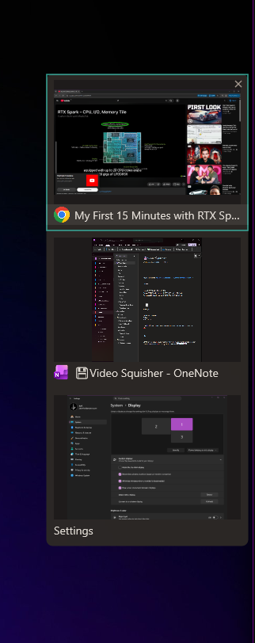

# EdgePOP by KitKarl

Hover the border between two monitors and EdgePOP shows you the windows on
the *other* screen. Click one and you're there.

I run three monitors off a single taskbar and got tired of alt-tab roulette,
so I built the switcher I wanted: fling the cursor at the seam, stop for a
beat, and the popup is already under your hand. Move away and it's gone.
Nothing to hold down, nothing extra to install, no taskbar replacement.

2MB installer and 10MB ram usage! None of these badly written 500mb mini-utilities that bog down your system!


## The short version

- windows from the other monitor as live thumbnail cards, or a compact
  icon + title list if you rather
- click a card to switch, press 1-9 to switch by number, Esc to close
  (doesnt need the mouse), or just move the cursor away
- optional close buttons on the cards: kill a window without going to it
- peek: hovering an entry ghosts the other windows on that screen, so you
  can tell which is which before you commit
- taskbar arrows on Windows 11: little indicators under your taskbar icons
  that say which screen an app lives on
- app blacklist, per-edge on/off, two activation modes, virtual desktop
  filtering. All in Settings, all applies the second you change it.

<br/>
<div align="center">
  
  <br>
  <small>Taskbar indicators that indicate where your windows are!</small>
</div>
<br/>
<div align="center">
  
  <br>
  <small>List of your apps on the neighboring window- in any direction!</small>
</div>
<br/>
The two feature sets (edge popup, taskbar arrows) live on seperate tabs in
Settings. Every row has a small (?) that opens a help card if you want the
longer explanation.

If there is some feature that you don't like or you want, let me know! I'm always looking to make it better!

## Download

- installer: [releases page](https://github.com/KitKarl-git/EdgePop/releases)
- same thing from my site: [kitkarl.com/edgepop](https://kitkarl.com/edgepop/)

Free. About a 2 MB download, installs per-user (no admin prompt), runs from
the tray, roughly 10 MB of RAM. No ads, no account, no telemetry.

**Requirements:** Windows 11, or Windows 10 version 1809 (the October 2018
update) and newer. The taskbar arrows need the Windows 11 taskbar and turn
themselves off on Windows 10; everything else works on both.

## Settings

Right-click the tray icon. Changes apply instantly and land in
`EdgePop.ini` next to the exe.

## Building from source

Visual Studio 2022 Build Tools (the C++ workload) and CMake:

```
cmake -S . -B build -G "Visual Studio 17 2022" -A x64
cmake --build build --config Release
```

There are unit tests for the trigger state machine, the window filter and
the settings round-trip:

```
cmake --build build --config Release --target edgepop_trigger_test edgepop_winenums_test edgepop_settings_test
build\Release\edgepop_trigger_test.exe
build\Release\edgepop_winenums_test.exe
build\Release\edgepop_settings_test.exe
```

Plain Win32 plus Direct2D/DirectComposition, statically linked CRT, no
runtime DLLs. I like utilities that stay small.

## Why is the first release 1.2?

EdgePOP lived on my machine and my site for a while before I put it on
GitHub. 1.0 and 1.1 went out as downloads from kitkarl.com only. Between
1.1 and 1.2 a pile of popup sizing and scrolling fixes occured, and this
seemed like a good moment to open the source up.

## More of my software

- [Image Squisher](https://kitkarl.com/imagesquisher/) - drop photos in
  (iPhone HEIC too), get much smaller photos out
- [Video Squisher](https://kitkarl.com/squisher/) - the same trick for
  video files
- everything else: [kitkarl.com](https://kitkarl.com)

If EdgePOP saves you some alt-tabbing, [a coffee is always
appreeciated](https://kitkarl.com/donate/).

## License

Free to use, for anyone. All rights reserved - please don't sell it or
bundle it into anything sketchy.
